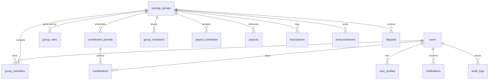

# AdashiCircle ⭕

> **Save Together. Grow Together.**  
> A digital cooperative savings and contribution management platform modernizing traditional Nigerian **Adashi**, **Ajo**, and **Esusu** rotating savings associations (ROSCAs).

[](https://nodejs.org/)
[](https://nextjs.org/)
[](https://developer.mozilla.org/en-US/docs/Web/JavaScript)
[-3ecf8e)](https://supabase.com/)
[-brightgreen)](https://nodejs.org/api/test.html)

---

## 🌟 Overview & Problem Statement

Millions of individuals, market traders, workplace colleagues, and families in Nigeria participate in informal cooperative savings arrangements commonly called **Adashi**, **Ajo**, or **Esusu**.

Traditionally, these groups rely on:
- Paper notebooks that can get lost, torn, or altered.
- Scattered WhatsApp group messages and screenshots buried in chats.
- Verbal confirmations and manual mental calculations.
- Disputed payout dates and lack of verifiable financial statements.

**AdashiCircle** modernizes this cultural savings tradition through automation, mathematical accuracy, and transparent digital recordkeeping.

---

## 🚀 Key Features

### 1. 100% Pure JavaScript Architecture
- Built entirely in **JavaScript** (`.js` and `.jsx`) using Next.js 14 App Router, Tailwind CSS, and Shadcn UI primitives.
- Clean ES6+ code without TypeScript compile overhead or complex typing friction.

### 2. High-Precision Financial Engine (Zero Floating-Point Drift)
- All monetary records are strictly stored as **integers in kobo** (`1 Naira = 100 kobo`).
- Eliminates binary floating-point rounding errors (`0.1 + 0.2 !== 0.3`).
- Handles periodic contributions, outstanding balance tracking, late penalty rules, and rotational pool calculations with exact integer arithmetic.

### 3. Three Supported Savings Models
- **Rotational Savings (Traditional Ajo / Esusu)**: Members contribute fixed amounts each period; total accumulated pool is paid to one member per rotation based on assigned positions (#1 to #N).
- **Target Goal Savings**: Group members contribute towards a shared milestone (e.g. bulk market purchases, investments, family projects).
- **Fixed-Term Cooperative**: Periodic contributions over a set period (e.g. 12 months) before total distributions and dividends.

### 4. Interactive Public Landing Page (`/`)
- **Static, Professional Fintech Design**: Crisp, clean presentation without distracting animations or floating elements.
- **Interactive Payout Calculator**: Real-time sliders adjusting contribution amounts (₦5,000 to ₦200,000) and member counts (3 to 30) with dynamic cycle duration and pool sizing.
- **Why Not WhatsApp? Comparison**: Side-by-side breakdown contrasting paper/chat headaches against automated digital records.
- **Savings Models Showcase**: Clear use-case guides for traders, friends, and corporate societies.
- **Interactive FAQ Accordion**: Expandable answers explaining custody, proof verification, and statement generation.

### 5. Supabase Auth & Edge Security
- **Cookie-Based Session Sync**: Integrated with `@supabase/ssr` to synchronize sessions between edge middleware and browser clients.
- **Edge Route Protection (`src/middleware.js`)**: Guards `/dashboard/*`, `/groups/*`, `/profile/*`, and `/admin/*`. Validates session via `supabase.auth.getUser()` to protect against JWT header spoofing.
- **Nigerian Phone Number Validation**: Full regex validation for `+234...` and `080/090/070...` formats.
- **Instant Demo Mode (`/api/auth/demo`)**: One-click local preview session allowing immediate testing without requiring live Supabase credentials.

### 6. Circle Operations & Payment Engine
- **Member Payment Submission**: Members upload payment method (Bank Transfer, USSD, Cash), receipt reference, and notes. Initial status: `awaiting_verification`.
- **Admin Verification Queue**: Group organizers can inspect incoming payment references and click **Approve** or **Reject** with reason tracking.
- **Admin Cash Recording Modal**: Organizers can log physical cash or POS deposits on behalf of any member.
- **Rotational Payout Disbursal**: Organizers record payout reference codes and mark rotation positions as completed.
- **Notice Board / Announcements**: Pin important reminders, meeting notes, and payout celebrations to the circle feed.
- **Branded Statement Exports**: Instant one-click **CSV** and formatted **PDF** statement downloads via PapaParse and jsPDF.

### 7. Dispute Resolution Center (`/dashboard/disputes`)
- Structured ticketing system for members to report unconfirmed transfers, position queries, or payout delays.
- Admin review workspace with formal resolution notes and status tracking (`open`, `under_review`, `resolved`, `dismissed`).

### 8. Immutable Financial Audit Ledger (`/dashboard/transactions`)
- Centralized ledger displaying all debits, credits, and adjustments.
- Real-time calculation of Total Inflows (savings deposits) and Total Outflows (payout disbursements).
- Searchable by transaction reference and filterable by type.

### 9. Super Administrator Governance (`/admin`)
- Platform-wide KPI overview: total pool volume, active circle counts, registered user accounts, and ledger health.
- Circle oversight table with **Suspend / Activate** controls.
- User management table with account status toggles.
- Live stream of immutable audit logs with timestamps and IP addresses.

---

## 🏗️ Architecture & Database Design

AdashiCircle is backed by **18 normalized PostgreSQL tables** with automated triggers and Row Level Security (RLS) policies:



### Complete Database Schema (`supabase/migrations/001_initial_schema.sql`):
1. `users` — Auth-linked user accounts
2. `user_profiles` — Profile details, avatar URLs, and Nigerian phone numbers
3. `savings_groups` — Group configurations, categories, and contribution amounts
4. `group_rules` — Grace periods, late penalties, and payout distribution rules
5. `group_members` — Member roles (`admin`, `member`) and assigned payout rotation positions
6. `group_invitations` — 8-character unique alphanumeric invite codes
7. `contribution_periods` — Auto-generated periods (start, end, and due dates)
8. `contributions` — Payment records, receipt references, and verification statuses
9. `contribution_adjustments` — Traceable financial corrections
10. `payout_schedules` — Rotational position assignments and due dates
11. `payouts` — Payout execution and disbursal references
12. `transactions` — Immutable financial audit ledger
13. `notifications` — In-app alerts and notifications
14. `notification_preferences` — Email, SMS, and in-app channel settings
15. `disputes` — Dispute tickets and categories
16. `dispute_history` — Audit trail of dispute status updates
17. `announcements` — Broadcasted circle notice board posts
18. `audit_logs` — System-wide security and action event log

---

## 📁 Project Directory Structure

```
AdashiCircle/
├── __tests__/                      # Automated test suite
│   ├── financial.test.js           # Kobo math, balance & payout formulas
│   └── utils.test.js               # Date generation, slugs, Nigerian phones
├── public/                         # Static assets & icons
├── src/
│   ├── app/
│   │   ├── admin/page.jsx          # Super Admin Governance Console
│   │   ├── api/auth/demo/route.js  # Instant Demo Session handler
│   │   ├── auth/callback/route.js  # Supabase OAuth/email verification
│   │   ├── dashboard/
│   │   │   ├── contributions/      # Member contribution tracking
│   │   │   ├── disputes/           # Dispute resolution center
│   │   │   ├── groups/             # My Circles overview
│   │   │   │   ├── [id]/page.jsx   # Circle Detail, Actions & Notice Board
│   │   │   │   ├── join/page.jsx   # Join Circle with 8-character invite code
│   │   │   │   └── new/page.jsx    # Circle Creation Wizard & Period Generator
│   │   │   ├── notifications/      # In-app alerts & notifications
│   │   │   ├── payouts/            # Rotational payout timeline
│   │   │   ├── profile/            # User profile management
│   │   │   ├── settings/           # Notification preferences
│   │   │   ├── transactions/       # Immutable Financial Audit Ledger
│   │   │   └── page.jsx            # Main Member & Organizer Dashboard
│   │   ├── forgot-password/        # Password recovery email request
│   │   ├── login/page.jsx          # User login with Instant Demo fallback
│   │   ├── register/page.jsx       # User registration with phone validation
│   │   ├── reset-password/         # Password update form
│   │   ├── globals.css             # Tailwind design tokens & themes
│   │   ├── layout.jsx              # Global root layout with Toaster & Theme
│   │   └── page.jsx                # High-conversion public landing page
│   ├── components/
│   │   ├── auth/auth-guard.jsx     # Client-side route protection guard
│   │   ├── layout/
│   │   │   ├── auth-layout.jsx     # Split-screen auth branding shell
│   │   │   ├── dashboard-layout.jsx# Main authenticated application shell
│   │   │   ├── header.jsx          # Application top navigation
│   │   │   └── sidebar.jsx         # Collapsible navigation drawer
│   │   └── ui/                     # Reusable Shadcn UI primitives
│   ├── hooks/
│   │   └── use-auth.js             # Authentication hook with demo fallback
│   ├── lib/
│   │   ├── supabase/
│   │   │   ├── client.js           # Browser client (@supabase/ssr)
│   │   │   ├── server.js           # Server client (@supabase/ssr)
│   │   │   ├── middleware.js       # Session refresh helper
│   │   │   └── service.js          # Admin service-role client
│   │   ├── utils/
│   │   │   ├── financial.js        # Kobo/Naira math & balance calculations
│   │   │   ├── dates.js            # Period generators & date formatters
│   │   │   └── index.js            # Slugs, codes & Nigerian phone validators
│   │   ├── audit.js                # System audit logger
│   │   ├── notifications.js        # Notification dispatcher
│   │   ├── reports.js              # CSV & PDF statement generation engine
│   │   └── validations/index.js    # Zod validation schemas
│   └── middleware.js               # Edge middleware route guard
├── supabase/
│   └── migrations/
│       ├── 001_initial_schema.sql  # 18-table PostgreSQL schema + triggers + RLS
│       └── 002_seed_data.sql       # Sample circle seed script
├── package.json
└── README.md
```

---

## 🛠️ Getting Started Locally

### Prerequisites
- [Node.js](https://nodejs.org/) v18+ (tested on Node v20/v24)
- [npm](https://www.npmjs.com/) or [pnpm](https://pnpm.io/)

### 1. Clone the Repository
```bash
git clone https://github.com/Auna19/AdashiCircle.git
cd AdashiCircle
```

### 2. Install Dependencies
```bash
npm install
```

### 3. Configure Environment Variables
Create a `.env.local` file in the root directory:

```env
# --- Supabase Configuration ---
NEXT_PUBLIC_SUPABASE_URL=https://your-project-ref.supabase.co
NEXT_PUBLIC_SUPABASE_ANON_KEY=your-anon-key-here
SUPABASE_SERVICE_ROLE_KEY=your-service-role-key-here

# --- Application Configuration ---
NEXT_PUBLIC_APP_URL=http://localhost:3000
NEXT_PUBLIC_APP_NAME=AdashiCircle
```

> **Instant Demo Mode**: If you run without connecting live Supabase keys, AdashiCircle automatically activates **Demo Mode**. You can click **"Instant Demo →"** on the login page or visit `/api/auth/demo` to explore the full platform with realistic mock data immediately.

### 4. Database Setup (Supabase PostgreSQL)
1. Create a project at [supabase.com](https://supabase.com).
2. Open the **SQL Editor** in your Supabase dashboard.
3. Paste the contents of [`supabase/migrations/001_initial_schema.sql`](supabase/migrations/001_initial_schema.sql) and click **Run**.
   - *This creates all 18 tables, triggers, RLS policies, and automatically grants Data API permissions with `NOTIFY pgrst, 'reload schema'`.*
4. (Optional) Run [`supabase/migrations/002_seed_data.sql`](supabase/migrations/002_seed_data.sql) to populate sample circles (`Lagos SME Cooperative Circle`), rotation periods, and transactions.
5. Copy your project URL, anon key, and service role key into `.env.local`.

> **💡 Tip for Frictionless Local Testing**: In your Supabase Dashboard, go to **Authentication** → **Providers** → **Email**, and toggle off **Confirm email**. This allows new users created on `/register` to sign in instantly without needing to verify an email inbox.

### 5. Run Development Server
```bash
npm run dev
```

Open your browser and navigate to:
👉 **[http://localhost:3000](http://localhost:3000)** (or `http://localhost:3001` if port 3000 is occupied).

---

## 🧪 Testing & Verification

AdashiCircle includes an automated unit test suite verifying financial calculations, date scheduling, and validation helpers:

```bash
npm test
```

### Test Coverage Highlights:
- ✅ Accurate conversion of integer kobo to Naira and Naira to kobo.
- ✅ Correct outstanding balance calculation (preventing negative arrears on overpayment).
- ✅ Rotational payout amounts with optional cooperative fee deductions.
- ✅ Overdue payment detection and day counters.
- ✅ Daily, weekly, biweekly, and monthly contribution period generation.
- ✅ 8-character invitation code generator (excluding ambiguous chars `0, 1, I, O`).
- ✅ Strict Nigerian phone number validation (`+234` and `080/090/070`).

### Production Build Verification:
```bash
npm run build
```
Builds all 21 static and dynamic App Router routes with zero compilation errors.

---

## 🔒 Security & Data Integrity Principles

- **No Fund Custody in MVP**: AdashiCircle acts as an intelligent digital recordkeeper and reconciliation system. Group members pay directly to the agreed group account or rotational recipient.
- **Immutable Transaction Records**: Financial ledger rows (`transactions`) are append-only. Corrections require explicit adjustment records rather than silent edits.
- **Row Level Security (RLS)**: Enforced at the PostgreSQL level to ensure members can only query circles and financial records they are authorized to access.
- **Edge Authentication**: Edge middleware verifies the JWT against Supabase's auth server on every protected request.

---

## 📄 License

This project is licensed under the [MIT License](LICENSE).

---

**AdashiCircle Technologies** · *Save Together. Grow Together.*
